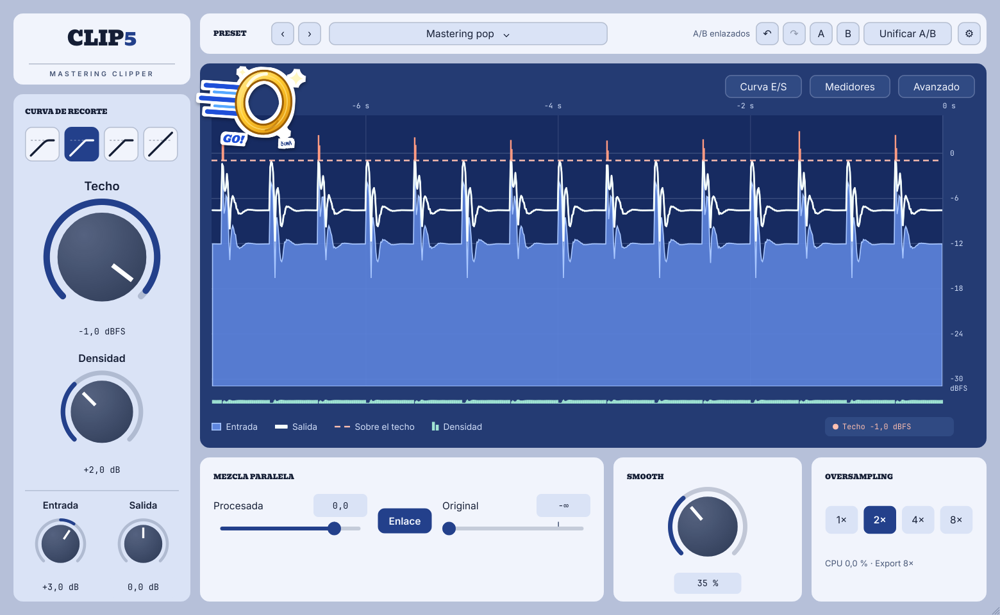

# clip5

Clipper de mastering de alta eficiencia con ganancia no lineal (**Densidad**), cuatro modos de
recorte, contorno dinámico de agudos (**Suavizado**), **Tono** integrado en la decimación,
**Techo estricto** true peak y mezclador paralelo real. Interfaz completamente en español.



## Estado

| Fase | Contenido | Estado |
|---|---|---|
| 1 | Cadena, prototipo de curvas (Python), aliasing, mockup | ✅ `docs/fase1/` |
| 2 | Núcleo fusionado con tablas + ADAA, sobremuestreo, benchmark | ✅ `dsp/`, `bench/` |
| 3 | Suavizado, decimación con Tono, Techo estricto, mezclador, latencia | ✅ `dsp/` |
| 4 | Medición (pico, TP, LUFS), Reloj de recorte, display | ✅ `dsp/`, `plugin/Source/ui/` |
| 5 | Plugin JUCE, UI, A/B, presets, validación, reporte de CPU | ✅ `plugin/`, informe final |
| 0.10 | Rediseño de interfaz: 10 temas con stickers propios, paneles, teclado | ✅ `docs/rediseno/`, `plugin/Source/ui/` |

Informe completo con resultados, decisiones y pendientes: **`docs/informe_final.html`**.

## Formatos y plataformas

VST3, AU (macOS), CLAP, Standalone; AAX si se dispone del AAX SDK (`-DCLIP5_AAX_SDK_PATH=…`).
macOS Universal (arm64 + x86_64) y Windows x64 vía CI (`.github/workflows/ci.yml`); Linux x64.

## Compilar

Requiere CMake ≥ 3.22 y un compilador C++20. JUCE 8.0.15, Catch2 3 y clap-juce-extensions se
descargan automáticamente (FetchContent).

```bash
cmake -S . -B build -DCMAKE_BUILD_TYPE=Release
```

```bash
cmake --build build --config Release --parallel
```

Pruebas y benchmark:

```bash
ctest --test-dir build -C Release --output-on-failure
```

```bash
./build/clip5_bench --segundos 30 --json benchmark.json
```

Linux necesita: `libasound2-dev libx11-dev libxrandr-dev libxinerama-dev libxcursor-dev libxext-dev
libxcomposite-dev libfreetype-dev libfontconfig1-dev libgl1-mesa-dev`.

## Estructura

```
dsp/        motor DSP sin JUCE (C++20): curvas, tabla + ADAA, filtros, Techo estricto, medición
tests/      Catch2: curvas, filtros, motor (null test, latencia, true peak, aliasing…), medición
bench/      benchmark de CPU (ruido rosa + música sintética, todas las calidades)
plugin/     plugin JUCE: parámetros, procesador, presets, A/B, interfaz
tools/      captura de la interfaz con audio real (documentación / revisión visual)
proto/      prototipos en Python (fase 1 y diseño de filtros)
docs/       informes, capturas, benchmark, log de pluginval
```

## Licencias

- Código de clip5: propietario (definir antes de distribuir).
- **JUCE 8** se usa bajo AGPLv3 o licencia comercial de JUCE. Para distribuir clip5 como
  producto cerrado hace falta una licencia comercial de JUCE.
- Fuentes embebidas: Inter (SIL OFL 1.1) y JetBrains Mono (OFL 1.1 / Apache 2.0);
  textos en `plugin/Resources/fonts/`.
- VST3 SDK (incluido en JUCE): revisar la licencia de la versión incluida antes de distribuir.
