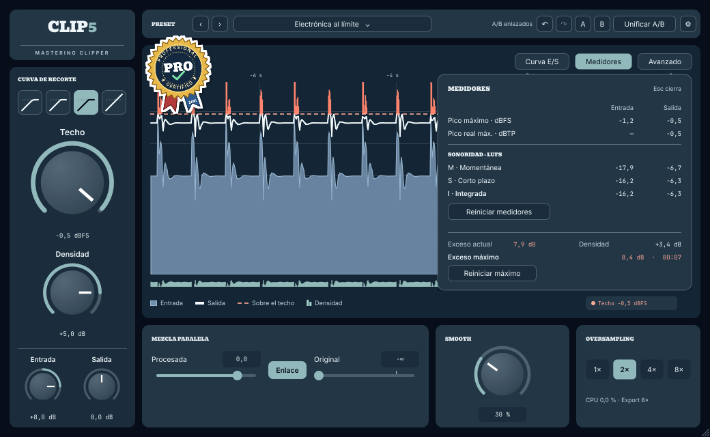
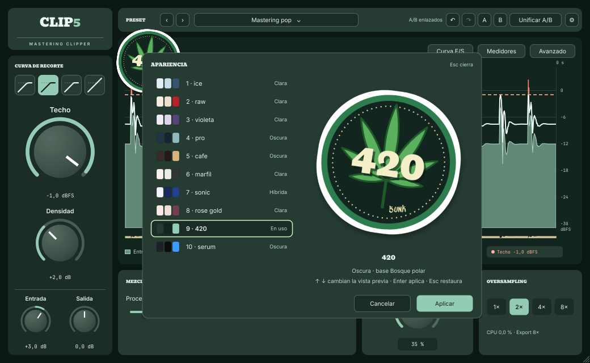

# clip5 — Manual de usuario

**Versión 0.10.0 (beta)** · Clipper de mastering con Densidad, Smooth y mezcla paralela

---

## Índice

1. [Qué es clip5](#1-qué-es-clip5)
2. [Requisitos](#2-requisitos)
3. [Instalación](#3-instalación)
4. [Primeros pasos](#4-primeros-pasos)
5. [La interfaz](#5-la-interfaz)
6. [Controles](#6-controles)
7. [Paneles: Curva E/S, Medidores y Avanzado](#7-paneles-curva-es-medidores-y-avanzado)
8. [Apariencia y temas](#8-apariencia-y-temas)
9. [Oversampling y latencia](#9-oversampling-y-latencia)
10. [Flujos de trabajo recomendados](#10-flujos-de-trabajo-recomendados)
11. [Presets de fábrica](#11-presets-de-fábrica)
12. [Teclado y atajos](#12-teclado-y-atajos)
13. [Solución de problemas](#13-solución-de-problemas)
14. [Especificaciones técnicas](#14-especificaciones-técnicas)
15. [Créditos y licencias](#15-créditos-y-licencias)

---

## 1. Qué es clip5

clip5 es un **clipper de mezcla y mastering**: sube el volumen percibido recortando los picos
por encima de un **Techo**, sin el bombeo de un compresor o limitador. Suma tres herramientas
para que el resultado suene limpio:

- **Densidad**: realce instantáneo de los pasajes de bajo nivel, sin tocar los picos.
- **Smooth**: suaviza los medios-agudos ásperos que genera el recorte, solo cuando hay recorte.
- **Mezcla paralela**: combina la rama **Procesada** con la **Original**, alineadas a la muestra.

Todo se procesa con oversampling y antialiasing (ADAA), con un consumo de CPU muy bajo.

## 2. Requisitos

| | Windows | macOS |
|---|---|---|
| Sistema | Windows 10 u 11 de 64 bits | macOS 10.13 o posterior (Intel y Apple Silicon) |
| Formatos | VST3, CLAP, aplicación independiente | AU, VST3, CLAP, aplicación independiente |
| DAW | cualquier DAW compatible con VST3 o CLAP de 64 bits | Logic Pro, Ableton Live, Reaper, Cubase, FL Studio, Studio One… |

> **Pro Tools (AAX)** todavía no está incluido en esta beta.

## 3. Instalación

### Windows

1. Abre `clip5-0.10.0-Windows-Setup.exe`.
2. Si aparece **"Windows protegió su PC"** (SmartScreen), haz clic en **Más información → Ejecutar
   de todas formas**. Aparece porque esta beta todavía no está firmada digitalmente.
3. Elige los formatos que quieres instalar (por defecto, todos) y sigue el asistente.
4. Abre tu DAW y vuelve a escanear los plugins si no aparece clip5.

Ubicaciones:

| Formato | Carpeta |
|---|---|
| VST3 | `C:\Program Files\Common Files\VST3\clip5.vst3` |
| CLAP | `C:\Program Files\Common Files\CLAP\clip5.clap` |
| Aplicación | `C:\Program Files\clip5\clip5.exe` (acceso en el menú Inicio) |

**Actualizar desde 0.9.0:** instala encima; las sesiones y los presets propios se conservan.
**Desinstalar:** Configuración → Aplicaciones → clip5 → Desinstalar.

### macOS

1. Abre `clip5-0.10.0-macOS.pkg`.
2. Si macOS dice que **no se puede abrir porque es de un desarrollador no identificado**:
   haz clic derecho (o Control+clic) sobre el archivo → **Abrir** → **Abrir**.
   En macOS 15 o posterior: **Ajustes del Sistema → Privacidad y seguridad → Abrir igualmente**.
3. En **Personalizar** puedes elegir qué formatos instalar.
4. Abre tu DAW. Logic Pro valida los plugins AU automáticamente la primera vez.

| Formato | Carpeta |
|---|---|
| AU | `/Library/Audio/Plug-Ins/Components/clip5.component` |
| VST3 | `/Library/Audio/Plug-Ins/VST3/clip5.vst3` |
| CLAP | `/Library/Audio/Plug-Ins/CLAP/clip5.clap` |
| Aplicación | `/Applications/clip5.app` |

## 4. Primeros pasos

1. Inserta clip5 en el **máster**, **al final de la cadena** (o justo antes de tu limitador final),
   o en un bus o pista.
2. Carga el preset **"Mastering pop"** como punto de partida.
3. Ajusta **Techo** al nivel máximo que quieres, por ejemplo **−1,0 dBFS** para streaming.
4. Sube **Entrada** de a poco mirando el gráfico: las marcas de **sobre el techo** muestran cuánto
   se recorta. En mastering suelen sonar bien excesos de **1 a 3 dB** en los golpes.
5. Si el recorte suena áspero, sube **Smooth**. Si falta cuerpo en los pasajes suaves, sube
   **Densidad**.
6. Compara con **A/B** y activa **Compensación de Densidad** en Avanzado para comparar a igual nivel.

## 5. La interfaz

- **Columna izquierda**: **Curva de recorte** (cuatro cuadraditos con el dibujo de cada curva),
  **Techo**, **Densidad** y, al pie, **Entrada** y **Salida**.
- **Barra superior**: preset con ‹ ›, estado A/B, deshacer, rehacer, **A**, **B**, **Unificar A/B**
  y **⚙** (Apariencia, escala de la interfaz y frecuencia del gráfico).
- **Gráfico de niveles** (últimos ~8 s), con el **sticker** del tema pegado en la esquina:
  - **Entrada**: área rellena con borde.
  - **Salida**: línea continua.
  - **Sobre el techo**: techo discontinuo y marcas del exceso antes de la curva.
  - **Densidad**: banda inferior con el realce estimado.
  - Botones **Curva E/S**, **Medidores** y **Avanzado** para abrir los paneles.
- **Fila inferior**: **Mezcla paralela**, **Smooth** y **Oversampling** (con CPU y factor de exportación).

## 6. Controles

| Control | Rango · inicial | Qué hace |
|---|---|---|
| **Techo** | −36 a 0 dBFS · −1,0 | Referencia de la curva, Densidad y Smooth. Con el Limitador True Peak activo, también es el objetivo en dBTP de toda la mezcla. |
| **Densidad** | 0 a +6 dB · 0,0 | Realce instantáneo a bajo nivel que cae gradualmente a 0 dB al llegar al Techo. Sin ataque ni release. |
| **Entrada** | ±12 dB · 0,0 | Ganancia previa a la curva: cuánto se empuja la rama procesada. **No afecta a Original.** |
| **Salida** | ±12 dB · 0,0 | Ganancia después de la mezcla paralela y antes del Limitador True Peak. |
| **Smooth** | 0 a 100 % · 0 % | Reduce dinámicamente medios-agudos cuando la señal se acerca al Techo o lo supera. El máximo (−2 o −3 dB) se elige en Avanzado. |
| **Procesada** | −∞ a +6 dB · 0 | Nivel de la rama procesada. |
| **Original** | −∞ a +6 dB · −∞ | Nivel de la señal original, tomada antes de Entrada y alineada en latencia. |
| **Enlace** | activado | Al mover un fader, el otro sigue un fundido de potencia constante. Desactívalo para ajustarlos por separado. |

### Curva de recorte

Pasa el puntero sobre cada cuadradito para ver su nombre.

| Curva | Sonido | Úsala para |
|---|---|---|
| **Suave** | Rodilla amplia con leve asimetría: redondea los picos de forma gradual | voces, acústicos, calidez |
| **Medio** | Rodilla simétrica más estrecha (la curva inicial) | mastering general |
| **Duro** | Lineal hasta el Techo y recorte abrupto | electrónica, transitorios |
| **Sin recorte** | Omite la curva; Densidad, Smooth y True Peak pueden actuar | dar densidad sin recortar |

## 7. Paneles: Curva E/S, Medidores y Avanzado

Se abren con los botones del gráfico; el mismo botón (o **Esc**) los cierra. Los controles
principales siguen disponibles con un panel abierto.

**Curva E/S**: transferencia estática de Densidad y la curva elegida, en dB relativos al Techo. La
diagonal punteada es ganancia unitaria.

**Medidores**:

| Lectura | Unidad | Significado |
|---|---|---|
| Pico máximo | dBFS | Pico de muestra de Entrada y Salida desde el último reinicio. |
| Pico real máx. | dBTP | Picos entre muestras a la salida final (en coral si supera el Techo). |
| M · S · I | LUFS | Sonoridad momentánea (400 ms), de corto plazo (3 s) e integrada (desde el reinicio). |
| Exceso actual / máximo | dB · mm:ss | Exceso sobre el Techo antes de la curva; el máximo indica cuándo ocurrió (posición de la DAW). |

- **Reiniciar medidores**: borra los picos máximos y las lecturas LUFS.
- **Reiniciar máximo**: borra el mayor exceso y su marca de tiempo.
- Una raya (—) indica una lectura todavía sin dato.

**Avanzado**:

| Opción | Opciones · inicial | Efecto |
|---|---|---|
| Oversampling al exportar | Igual / 1× / 2× / 4× / 8× · 8× | Se usa cuando la DAW renderiza fuera de tiempo real. |
| Fase del filtrado | Lineal / Mínima · Lineal | Lineal conserva la fase al mezclar ramas. Mínima reduce la latencia y puede cambiar la suma en agudos. |
| Limitador True Peak | activado | Anticipa picos entre muestras y usa el Techo como objetivo en dBTP. Desactívalo en usos paralelos con Techo bajo: también limitaría la señal Original. |
| Atenuación fija de agudos | Plano / Seda / Terciopelo · Plano | Ajuste tonal permanente: 0, −1 o −3 dB a 10 kHz. |
| Rango de Smooth | −2 / −3 dB · −2 dB | Atenuación máxima con Smooth al 100 %. |
| Compensación de entrada | desactivada | Aplica la ganancia inversa de Entrada a la rama procesada: cambia el carácter del recorte sin subir el volumen. |
| Compensación de Densidad | desactivada | Resta el valor nominal de Densidad en la rama procesada para comparar a igual nivel. |

## 8. Apariencia y temas

**⚙ → Apariencia…** (o clic sobre el sticker). Elige entre diez temas con vista previa en vivo;
**Aplicar** lo guarda como preferencia de tu equipo y **Cancelar** (o Esc) restaura el anterior.
El tema no viaja en los presets ni en las sesiones.

| # | Tema | Tipo | Sticker |
|---|---|---|---|
| 1 | ice | Clara | cubo de hielo |
| 2 | raw | Clara | librillo de papel crudo |
| 3 | violeta | Clara | cogollo violeta |
| 4 | pro | Oscura | sello «professional certified» |
| 5 | cafe | Oscura | café con arte latte |
| 6 | marfil | Clara | rifle (silueta) |
| 7 | sonic | Híbrida | anillo dorado a toda velocidad |
| 8 | rose gold | Clara | gatita kawaii |
| 9 | 420 | Oscura | insignia 420 |
| 10 | serum | Oscura | gotero con forma de onda |

Los colores cambian; los controles, la escala del gráfico y el significado de cada lectura son
los mismos en todos los temas.

## 9. Oversampling y latencia

| Oversampling | Cuándo usarlo |
|---|---|
| **1×** (con ADAA) | muchas instancias, sesiones pesadas |
| **2×** | inicial: excelente relación calidad/CPU |
| **4×** | mastering exigente |
| **8×** | exportación final (valor inicial de *Oversampling al exportar*) |

Latencia a 48 kHz (muestras), comunicada a la DAW:

| | 1× | 2× | 4× | 8× |
|---|---|---|---|---|
| Lineal · True Peak activo | 104 | 146 | 153 | 156 |
| Mínima · True Peak activo | 88 | 92 | 94 | 95 |
| Mínima · True Peak desactivado | 0 | 4 | 6 | 7 |

Cambiar el factor, la fase o el Limitador True Peak durante la reproducción produce un fundido
breve. La lectura **CPU** estima qué porcentaje del tiempo disponible por bloque usa esta instancia.

## 10. Flujos de trabajo recomendados

**Mastering pop**: carga el preset (Techo −1,0 dBFS, curva Medio, True Peak activo) → ajusta
Entrada en el pasaje más fuerte mirando *sobre el techo* → Smooth si los agudos se endurecen →
Salida para comparar el nivel → en Medidores revisa Pico real y LUFS I, y elige 8× al exportar.

**Bus de batería**: carga el preset (curva Duro, Techo −6 dBFS, Procesada 0 dB, Original −6 dB,
Enlace y True Peak apagados) → dosifica Original y Procesada por separado → ajusta Entrada para
cambiar cómo se recortan los golpes. Si activas True Peak, el Techo de −6 también se vuelve el
objetivo en dBTP de toda la suma.

**Densidad sin recorte**: carga el preset (curva Sin recorte, Densidad +4 dB, Smooth 20 %,
Compensación de Densidad activa) → alterna A/B y ajusta Densidad. Si vas a usar un limitador
posterior, desactiva el Limitador True Peak en Avanzado.

**Medir un tema completo**: antes de reproducir desde el inicio pulsa **Reiniciar medidores**; al
terminar, lee **I** en la columna Salida y el **Pico real** en dBTP.

**Comparar A/B**: A y B empiezan enlazados. Elige A, ajusta; elige B, ajusta otra cosa; alterna.
**Unificar A/B** conserva el ajuste activo y vuelve a enlazar.

## 11. Presets de fábrica

| Preset | Entrada / Densidad · dB | Techo · dBFS | Curva | Smooth | Otros ajustes |
|---|---|---|---|---|---|
| Transparente | 0 / 0 | −1,0 | Suave | 0 % | Punto de partida |
| Mastering pop | +3 / +2 | −1,0 | Medio | 35 % | True Peak activo |
| Densidad sin recorte | 0 / +4 | −0,3 | Sin recorte | 20 % | Compensación de Densidad |
| Bus de batería | +6 / +3 | −6,0 | Duro | 20 % | Original −6 dB; Enlace y True Peak apagados |
| Rock denso | +5 / +4 | −1,0 | Medio | 50 % | Seda |
| Electrónica al límite | +8 / +5 | −0,5 | Duro | 30 % | True Peak activo |
| Voz al frente | +4 / +3 | −3,0 | Suave | 60 % | Terciopelo, Original −10 dB; Enlace y True Peak apagados |
| Paralelo sucio | +10 / +6 | −12,0 | Duro | 0 % | Procesada −6, Original 0, Salida −3 dB; Enlace y True Peak apagados |

Los presets conservan el Oversampling, el Oversampling al exportar y la fase de la instancia.
**Presets propios:** menú de presets → **Guardar preset…** (se guardan en `Documentos/clip5/Presets`).

## 12. Teclado y atajos

| Acción | Puntero | Teclado |
|---|---|---|
| Moverse entre controles | — | **Tab** / **Shift+Tab** (el anillo marca el foco) |
| Ajustar perilla o fader | arrastrar; **Shift** = fino; rueda | **↑ ↓ ← →** (Shift = fino), **RePág/AvPág** |
| Escribir un valor | clic en el recuadro del valor o doble clic en la perilla | **Enter** abre; **Enter** aplica; **Esc** restaura |
| Valor inicial | **Ctrl+clic** (Windows) / **Cmd+clic** (macOS) | **Supr** |
| Fader a 0 dB | doble clic en el fader | — |
| Curva / Oversampling / opciones | clic | **← →** dentro del grupo |
| Interruptores y Enlace | clic | **Enter** o **Espacio** |
| Cerrar un panel | el mismo botón | **Esc** (devuelve el foco al botón) |
| Deshacer / Rehacer | ↶ ↷ | **Ctrl/Cmd+Z** · **Ctrl/Cmd+Shift+Z** |

Al escribir un valor se aceptan coma o punto; si el valor no es válido se mantiene el último
aplicado y se muestra el rango junto al campo. Pasa el puntero sobre cualquier control para ver
una ayuda en español.

## 13. Solución de problemas

| Problema | Solución |
|---|---|
| La DAW no encuentra clip5 | Vuelve a escanear los plugins y verifica que la carpeta VST3/CLAP esté en las rutas de la DAW. |
| Windows bloquea el instalador | "Más información → Ejecutar de todas formas" (beta sin firma). |
| macOS no deja abrir el .pkg | Clic derecho → Abrir, o Ajustes → Privacidad y seguridad → Abrir igualmente. |
| La salida supera el Techo | Activa el **Limitador True Peak** (Avanzado). Sin él, Original, Procesada > 0 dB o Salida > 0 dB pueden superarlo. |
| La mezcla paralela suena hueca | Usa **Fase Lineal**. |
| Mucho uso de CPU | Baja el Oversampling en tiempo real; la exportación usa *Oversampling al exportar*. |
| Las teclas no responden | Haz clic en el plugin para darle el foco; algunas DAW reservan atajos (por ejemplo, la barra espaciadora). |

## 14. Especificaciones técnicas

- Procesamiento interno en coma flotante de 32 bits; diseño de filtros en 64 bits.
- Núcleo no lineal fusionado (Densidad + curva) en tabla de 512 tramos cúbicos con ADAA.
- Oversampling: half-band FIR de fase lineal (≥ 105 dB) o half-band IIR de fase mínima (≥ 110 dB).
- Atenuación fija de agudos integrada en el filtro de decimación (rizado < 0,02 dB, rechazo > 100 dB).
- Limitador True Peak con anticipación guiado por pico real (4x + refinamiento parabólico).
- Medición: LUFS ITU-R BS.1770-4 (±0,1 LU) y pico real de salida.
- 44,1 a 192 kHz. Mono y estéreo. Interfaz escalable del 75 al 200 %, 10 temas.

## 15. Créditos y licencias

clip5 © 2026. Todos los derechos reservados. Ilustraciones de los stickers: diseño propio.
Desarrollado con JUCE. Fuentes: **Bevan**, **Inter** y **JetBrains Mono** (SIL Open Font License
1.1); firma 5unk en **Sedgwick Ave Display** (SIL OFL 1.1). VST es una marca registrada de
Steinberg Media Technologies GmbH. Audio Units y macOS son marcas de Apple Inc. Windows es una
marca de Microsoft Corporation.
